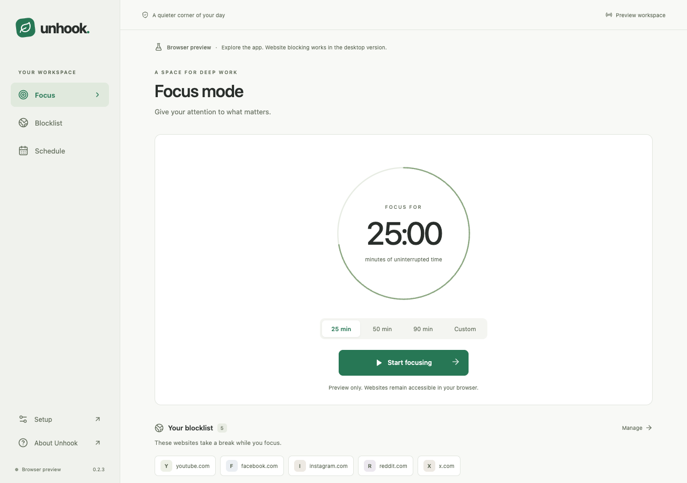

# Unhook

A local-first desktop website blocker for focused work. Start a timed session or set a weekly schedule, then let Unhook keep distracting sites out of the way.

Built with **Tauri 2, React 19, TypeScript, and Rust**. No accounts, analytics, cloud services, or remote blocklist requests.



## Project status

Unhook is in development/private beta. The macOS app is used locally; signed public downloads, extension-store distribution, and clean-machine release acceptance remain outstanding. Windows and Linux have build/verification jobs configured, but native installation and enforcement still need platform acceptance.

The browser preview is a safe way to explore the interface. It simulates settings and sessions and **does not block websites**.

## Features

- **Focus sessions:** block selected domains for a chosen duration, with an option to stop early.
- **Weekly schedules:** selected weekdays, same-day work hours, and an optional break; valid edits save immediately.
- **Browser companion:** Chrome/Brave request blocking that follows the desktop app's accepted state.
- **Quiet interruptions:** a leaf releases and settles on the blocked page, with one immediate Close tab action and a static reduced-motion alternative.
- **Optional system blocking on macOS:** an authenticated helper applies a bounded lease and restores Unhook's entries when the app stops refreshing it.
- **Tray operation:** closing the window keeps scheduling alive; quitting stops focus. Launch at login is an explicit option on macOS 13+.

## Try the interface

Use Node.js 24.12 or later (24 LTS recommended):

```sh
npm ci
npm run dev
```

Open [127.0.0.1:1420](http://127.0.0.1:1420). The preview runs entirely in the browser, with simulated state in localStorage. The separate [blocked-page preview](http://127.0.0.1:1420/extension/blocked.html) shows the interruption without accessing task storage.

For native development, install stable Rust and the [Tauri prerequisites](https://v2.tauri.app/start/prerequisites/) for your operating system. Follow the [fixture-based development guide](CONTRIBUTING.md#native-development-with-fixtures) before running `npm run desktop`; normal native operation can register the browser host and interact with system integrations.

## Engineering decisions

- **Rust owns native state.** Timers, schedules, persistence, and enforcement intent live outside the webview. The interface uses a typed service boundary; native errors never silently switch to simulation.
- **Browser blocking is the default.** Session intent and actual hosts-file enforcement are separate states. Browser-only operations do not edit hosts.
- **Privilege is narrowly scoped.** The browser host reads a fixed private snapshot and acknowledges applied state. The macOS helper authenticates peers, uses fixed paths, and grants short leases rather than giving the GUI administrator privileges.
- **Hosts changes preserve other applications' data.** The engine validates its marked section, creates backups, and writes atomically while preserving unrelated bytes. Exact domains and explicit `www` companions receive IPv4 and IPv6 mappings.

The [architecture guide](docs/architecture.md) explains the components, data flow, and tradeoffs. The [implementation contract](docs/contract.md) defines IPC and runtime behavior.

## Development checks

```sh
npm run format:check
npm run typecheck
npm test
npm run build
```

Prettier is pinned for consistent source formatting; run `npm run format` to apply it. TypeScript uses strict checks, including unused locals and parameters. Vitest covers the interface, extension, and packaging scripts.

Before full Rust workspace checks, prepare the resources and sidecars in order:

```sh
npm run build
npm run prepare:browser-host
npm run prepare:system-helper
cargo fmt --all -- --check
rustfmt --edition 2021 --check native/macos/build-support.rs
cargo test --workspace
cargo clippy --workspace --all-targets -- -D warnings
```

`npm run test:core` runs the core engine tests without building the desktop app. See [CONTRIBUTING.md](CONTRIBUTING.md) for focused tests and verification boundaries.

## Behavior and limits

Manual focus takes priority over schedules and scheduled breaks. Ending focus skips the rest of the active scheduled window; editing the schedule clears that pause. Schedules use local wall-clock time and require Unhook to remain running while the computer is awake. Overnight windows are not supported.

Blocking matches exact domains and explicit `www` companions, not arbitrary subdomains. Existing browser connections, DNS caches, proxies, direct IP access, and deliberate bypasses limit enforcement. This is a focus aid, not a tamper-proof parental-control boundary.

The companion and system helper use expiring state/leases so a stopped app cannot indefinitely retain their active enforcement. Password-based or older builds can leave hosts entries requiring explicit **Restore system access**. Recovery removes only Unhook's marked section; never replace the entire hosts file from an old backup. See [operations and recovery](docs/operations.md).

## Packaging and installation

Build installers on their target operating system:

```sh
# macOS private beta: inspect the package without installing it
npm run package:macos -- --development

# Windows
npm run tauri -- build --bundles msi

# Linux
npm run tauri -- build --bundles deb
```

Outputs are under `target/release/bundle/`; macOS PKGs are in its `pkg/` directory. The PKG installs the app and persistent system daemon. The companion currently uses guided **Load unpacked** installation, once per browser profile.

Public macOS packages require matching Developer ID Application/Installer teams, final-package notarization/stapling, and clean-machine acceptance. Development packages and CI artifacts do not establish that those release checks have passed.

- [Browser companion setup and protocol](docs/browser-companion.md)
- [macOS installer and removal](docs/macos-installer.md)
- [System helper security boundary](docs/system-helper.md)
- [Release acceptance record](docs/beta-acceptance.md)
- [Historical verification notes](docs/verification.md)

If local macOS DMG packaging cannot send Apple events to Finder, `CI=true npm run tauri -- build --bundles dmg` skips cosmetic Finder layout automation without requesting extra OS permissions.

## Contributing and license

Read [CONTRIBUTING.md](CONTRIBUTING.md) for setup, code conventions, and safe verification. Contributions should preserve the privacy model and keep native contracts, TypeScript types, tests, and documentation aligned.

Licensed under the [MIT License](LICENSE).
