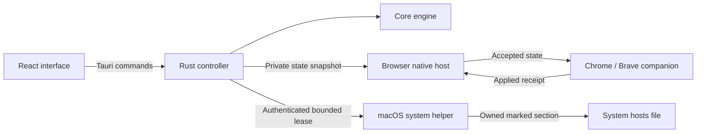

# Architecture

Unhook separates work intent from enforcement. The desktop app decides when focus is active; the browser companion and optional macOS system helper apply accepted state within short expiry boundaries.

No runtime component requires an account, remote API, analytics service, or downloaded blocklist.

## Components and ownership

| Component           | Source                                          | Responsibility                                                                                    |
| ------------------- | ----------------------------------------------- | ------------------------------------------------------------------------------------------------- |
| Interface           | `src/`                                          | React pages, accessibility, user feedback, and a typed native-service adapter                     |
| Desktop controller  | `src-tauri/src/`                                | Session intent, schedule evaluation, persistence, tray lifetime, and OS integration orchestration |
| Core engine         | `crates/unhook-core/`                           | Domain and schedule validation, hosts transactions, DNS operations, and a fixture-friendly CLI    |
| Browser host        | `crates/unhook-browser-host/`                   | Bounded native-message framing, fixed snapshot reads, and application receipts                    |
| Browser companion   | `extension/`                                    | Exact-domain request rules, existing/restored-tab checks, expiry, and a quiet blocked page        |
| macOS system helper | `crates/unhook-system-helper/`, `native/macos/` | Authenticated peer handling, fixed-path hosts enforcement, and bounded lease recovery             |
| Packaging           | `scripts/`                                      | Resource/sidecar preparation and inspected macOS installer construction                           |

The desktop publishes a private state snapshot for the browser host. The host exposes only state reads and successful-application acknowledgements; it does not expose session mutations or arbitrary file paths. The companion installs browser rules from that accepted state and acknowledges application. The desktop also requests bounded leases from the optional macOS helper, which changes only Unhook's marked hosts section.

## Native state and interface boundary

`src/service.ts` is the frontend's service boundary. Native operation calls Tauri commands; the explicitly labeled browser preview implements the same frontend interface with localStorage simulation. A failed native command cannot fall back to preview.

The Rust controller owns persisted settings, manual focus intent, local schedule evaluation, and countdowns. The webview displays accepted state and issues commands; closing the window does not stop the tray process. Quitting ends focus. Schedules require the app to remain running while the computer is awake.

Manual focus overrides scheduled focus and breaks. Stopping focus suppresses the current scheduled window; changing the schedule clears that suppression. Time windows use local wall-clock time, Monday = 0 through Sunday = 6, and reject overnight ranges. The full serialization and command contract lives in [contract.md](contract.md).

## Browser enforcement

The desktop writes `browser-state.json` atomically with user-only permissions. The native host reads that fixed file, validates framing/origin, and accepts only a constrained acknowledgement into a separate connection receipt.

The companion checks state once per second. Rules are bounded by the focus deadline and a 15-second heartbeat lease; disconnects clear active rules. It also checks existing tabs and restored navigations so enforcement does not depend only on new network requests.

The blocked page only reads accepted context and closes its own tab on request. It has no session controls and does not access the legacy local task store. Its one-shot leaf animation is optional under reduced-motion preferences and does not gate the close action.

See [browser-companion.md](browser-companion.md) for protocol negotiation, exact matching, and installation details.

## Optional system enforcement

Browser-only focus never edits hosts. On macOS, the optional system layer applies exact domains and explicit `www` companions with IPv4 and IPv6 mappings.

The engine parses only its marked section, refuses ambiguous markers, preserves unrelated bytes, creates backups, and replaces files atomically. The helper grants bounded leases, refreshed by the running app; expired or failed sessions trigger restoration. Password-based and older installations can require explicit recovery.

The PKG-installed helper authenticates the live peer and checks protected installer-approved code hashes. The embedded signed-app route uses same-team signature checks. Both keep paths fixed and the GUI unprivileged. Failed installed-service connections do not silently switch to password authorization.

See [system-helper.md](system-helper.md), [macos-installer.md](macos-installer.md), and [operations.md](operations.md) for the detailed trust model, upgrade behavior, and recovery procedure.

## Tradeoffs and limits

- Exact-domain matching is predictable and aligns browser/system behavior. Arbitrary subdomains require explicit entries; this is not wildcard filtering.
- The browser companion and hosts layer complement each other. DNS caches, existing connections, proxies, direct IP access, unsupported browsers, and deliberate bypasses remain limitations.
- Scheduling stays in the desktop process rather than a separate always-on scheduler. This keeps one owner for session intent, but requires the app to run.
- Independent app/companion release versions use an explicit acknowledgement protocol. Unknown protocols cannot establish readiness.
- UI preview, fixture tests, package inspection, and live installation acceptance prove different things. A successful build is not evidence of Gatekeeper approval or cross-platform enforcement.

## Where to start reading

- `src/App.tsx`, `src/useFocus.ts`, and `src/useSetup.ts` for interface orchestration.
- `src/service.ts` and `src/types.ts` for the frontend boundary.
- `src-tauri/src/controller.rs` and `src-tauri/src/session.rs` for session and schedule behavior.
- `crates/unhook-core/src/hosts.rs` for conservative hosts transactions.
- `extension/blocker.js` and `extension/rules.js` for browser enforcement.
- `crates/unhook-system-helper/src/installed.rs` for protected descriptor-relative access.

For safe local changes and the verification commands, read [CONTRIBUTING.md](../CONTRIBUTING.md).
